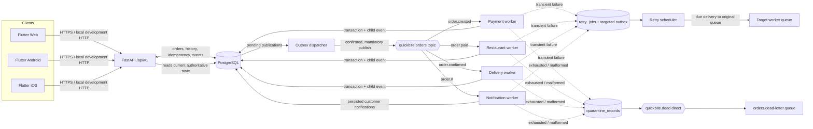

# Architecture

QuickBite is a full-stack food delivery order processing system.

- Backend: FastAPI (Python 3.11), SQLAlchemy 2 async, Alembic, PostgreSQL, aio-pika, RabbitMQ.
- Frontend: Flutter (Web/Android/iOS) with Provider state management.
- Messaging: durable topic exchange `quickbite.orders`, 4 workers, transactional outbox, retry scheduler, quarantine + dead-letter.

Flow: Customer checkout → API commits order + history + idempotency + outbox event (202) → outbox dispatcher publishes `order.created` → payment worker → `order.paid` → restaurant worker → `order.confirmed` → delivery worker → `order.driver.assigned`. Notification worker consumes `order.#` and persists notifications without changing status.

Money stored as integer minor units (INR 12.50 = 1250).

## Service and event flow

RabbitMQ is a transport; PostgreSQL remains the source of truth for order
state. An accepted order can remain `PENDING` while an outbox publication waits
for RabbitMQ recovery. Delivery is at least once, and consumers use
`(consumer_name, event_id)` deduplication so redelivery does not repeat
committed business effects.
